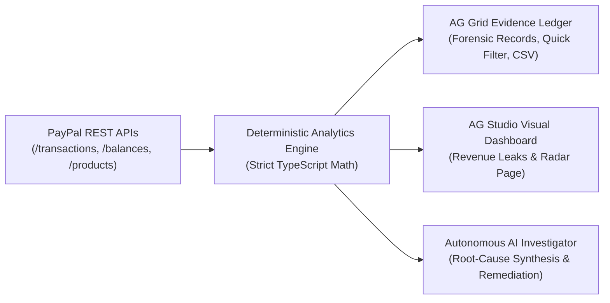

# 🔍 LeakLens AI — Autonomous Revenue Leak Investigator for PayPal Merchants

> **PayPal AI Hackathon 2026 Official Submission**  
> **Target Category:** AG Grid Sponsor Prize — *Best Use of AG Grid* ($2,000) & General Innovation Track

[](https://leaklens-ai.vercel.app)
[](https://nextjs.org/)
[](https://www.ag-grid.com/)
[](https://www.ag-grid.com/ag-studio/)
[](https://developer.paypal.com/)
[](https://www.typescriptlang.org/)

---

## 🌐 Live Production Deployment

Experience LeakLens AI live in production on Vercel:

| Destination | Live URL | Description |
| :--- | :--- | :--- |
| 🚀 **Flagship Command Center** | **[leaklens-ai.vercel.app/leaklens](https://leaklens-ai.vercel.app/leaklens)** | Full AI Anomaly Detector, AG Grid Evidence Ledger, and Natural Language Query Console |
| 📊 **AG Studio Dashboard** | **[leaklens-ai.vercel.app/dashboard](https://leaklens-ai.vercel.app/dashboard)** | Official AG Studio 3.0 visual report builder with our custom registered leak widgets |
| ⚡ **Home Navigation Hub** | **[leaklens-ai.vercel.app](https://leaklens-ai.vercel.app)** | Portal linking LeakLens AI, AG Studio, and raw PayPal REST endpoint grids |
| 🎬 **2-Minute Demo Studio** | Accessible on `/leaklens` | Click `▶ 2-Minute Demo Video Studio` at the bottom-right for the automated narrated tour |

---

## 💡 Elevator Pitch
**LeakLens AI** turns high-frequency PayPal payment and dispute activity into actionable margin defense. By fusing deterministic financial audit algorithms with an autonomous reasoning engine and high-density **AG Grid** interactive ledgers, LeakLens catches refund anomalies, authorization drop-offs, and fee creep before they drain merchant capital.

---

## 🎯 The Core Philosophy: "The LLM Proposes, Code Decides"
Traditional AI dashboards suffer from financial hallucination: generative LLMs routinely produce mathematical errors when summing tabular fees or calculating return ratios.

LeakLens AI enforces strict architectural separation:
1. **Deterministic Financial Math (TypeScript Engine):** Calculates exact return percentages, standard deviations, baseline variance, and dollar-denominated above-baseline capital losses.
2. **Autonomous Reasoning Layer (AI Auditor):** Contextualizes pre-calculated audit facts to uncover root causes and propose actionable remediation plans for merchants.



---

## ✨ Key Capabilities

### 1. High-Density AG Grid Evidence Ledger
- Styled with a dark **Midnight Quartz theme** (`themeQuartz.withParams`) designed for high-intensity financial audit workflows.
- Sub-millisecond client-side filtering by anomaly status (`All`, `Flagged Leaks`, `Declined`).
- Full-text instant search across all transaction fields.
- 1-click **Export CSV** powered by AG Grid Community's `CsvExportModule`.
- Custom cell renderers for status badges, net settlement flow indicators, and counterparty metadata.

### 2. AG Studio Deep Integration (`/dashboard`)
- Built directly into the official **AG Studio 3.0** visual report builder.
- Custom registered widgets:
  - `AboveBaselineRefundsWidget`: Quantifies dollar-denominated excess capital loss.
  - `RefundHotspotWidget`: SKU-level risk table highlighting defect surges.
  - `RevenueLeakFlowWidget`: Visual cash funnel tracking gross checkout volume to net retained cash.
- Dynamic drag-and-drop report layout customization.

### 3. Dual-Mode Financial Data Broker
- **Live PayPal Sandbox API:** Authenticates directly with `https://api-m.sandbox.paypal.com` using OAuth 2.0 client credentials.
- **Synthetic Audit Scenario:** High-fidelity 150+ transaction audit dataset engineered with real-world edge cases (38.5% refund surge on AI Add-On, 12 authorization declines, and cross-border fee spikes) for friction-free judge evaluation.

### 4. Interactive Command Center Header
- **Notification Flyout (Bell):** Real-time margin alert center with unread badges and one-click investigation links.
- **Architecture Guide Modal (?):** In-app documentation and quick shortcuts to official PayPal & AG Grid documentation.
- **Merchant Account Popover:** Live inspection of PayPal Sandbox connection status, settlement currency, and engine broker mode.

---

## 🚀 Quick Start (Run Locally)

### Prerequisites
- Node.js 20.9 or later
- npm or pnpm

### Installation
```bash
# Clone repository
git clone https://github.com/suradpavankumar-tech/leaklens-ai.git
cd leaklens-ai

# Install dependencies
npm install

# Configure environment (Optional: live PayPal credentials)
cp env.example .env.local

# Start development server
npm run dev
```

Open **[http://localhost:3000](http://localhost:3000)** in your browser:
- **Flagship Command Center:** [http://localhost:3000/leaklens](http://localhost:3000/leaklens)
- **AG Studio Dashboard:** [http://localhost:3000/dashboard](http://localhost:3000/dashboard)
- **Raw PayPal API Tables:** [http://localhost:3000/products](http://localhost:3000/products), [http://localhost:3000/transactions](http://localhost:3000/transactions)

---

## 📐 Project Structure

```
leaklens-ai/
├── app/
│   ├── (endpoints)/            # Official boilerplate PayPal REST grids
│   │   ├── products/           # Catalog products AG Grid
│   │   ├── transactions/       # Transaction search AG Grid
│   │   └── data-grid.tsx       # Reusable AG Grid component
│   ├── dashboard/              # AG Studio visual report builder
│   │   ├── components/         # Top bar, notifications, and modals
│   │   └── studio/             # Initial report definition & custom widgets
│   ├── leaklens/               # Flagship LeakLens AI Command Center
│   │   ├── page.tsx            # Server-rendered container
│   │   └── leaklens-client.tsx # Client-side reactive interface
│   └── api/leaklens/           # Summary & Investigation API routes
├── components/leaklens/        # LeakLens visual components
│   ├── CustomWidgets/          # EvidenceGridWidget, RefundHotspotWidget, etc.
│   ├── InvestigationPanel.tsx  # Natural language AI query console
│   └── LeakLensHeader.tsx      # Branded header with notifications & guide
└── lib/leaklens/               # Core deterministic analytics engine
    ├── types.ts                # TypeScript strict schemas
    ├── analytics.ts            # Math calculations (0% hallucination)
    ├── engine.ts               # Dual-mode data broker (Live / Demo)
    └── mock-data.ts            # High-fidelity 150+ audit dataset
```

---

## 🏆 Why LeakLens AI for "Best Use of AG Grid"
1. **Grid as the Forensic Ledger:** Rather than using AG Grid as a basic static table, LeakLens AI uses AG Grid as the primary evidentiary basis for AI recommendations.
2. **Bi-Directional Filtering:** Clicking an anomaly card in the executive summary automatically applies AG Grid filter expressions to isolate offending transactions.
3. **Custom Quartz Theming:** Bespoke Midnight Quartz styling tailored for financial terminals.
4. **AG Studio Extensibility:** Registers custom analytics widgets alongside native AG Grid components in the AG Studio visual report builder.

---

## 📄 License
This project is licensed under the Apache 2.0 License - see the LICENSE file for details. Built upon the official [paypaldev/hackathon-paypal-ag-grid-boilerplate](https://github.com/paypaldev/hackathon-paypal-ag-grid-boilerplate).
